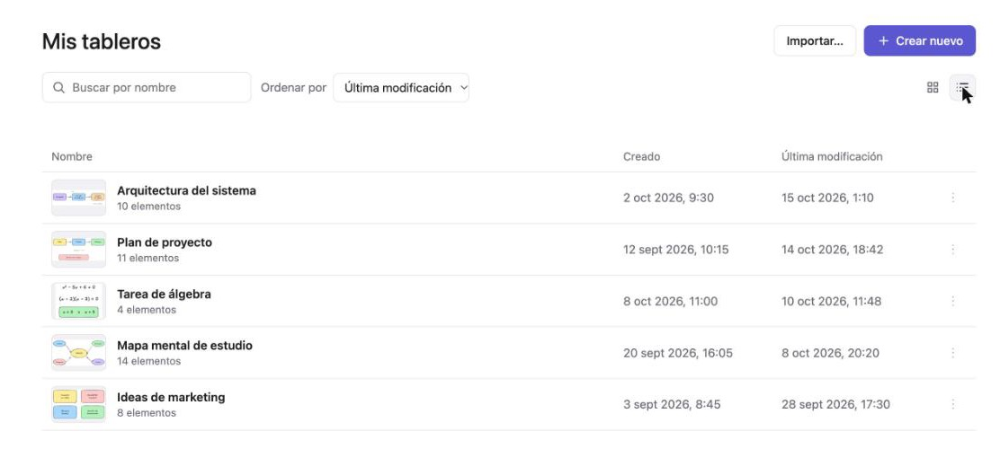
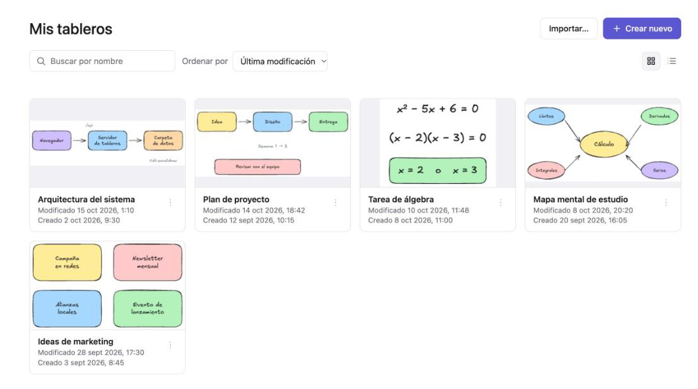
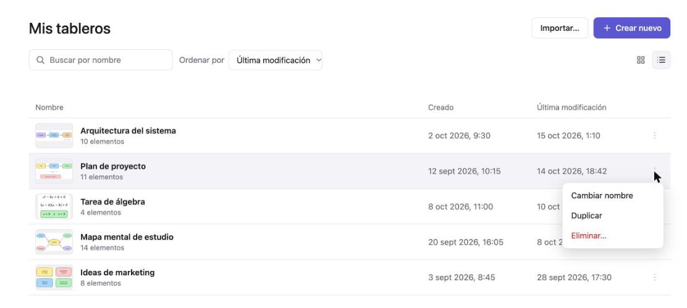
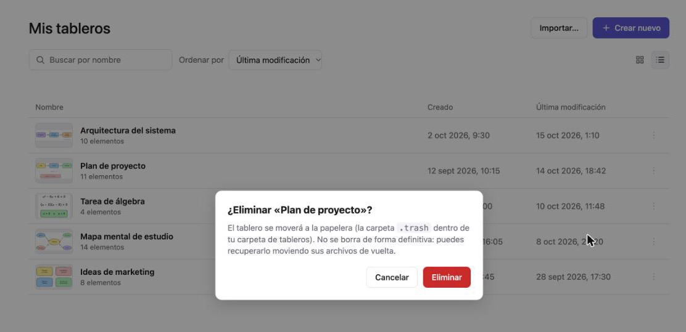
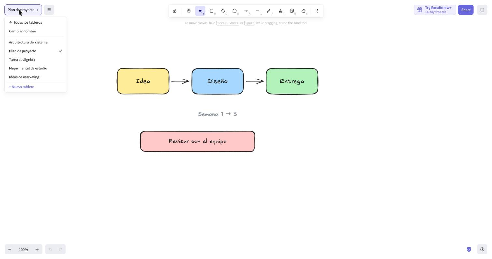
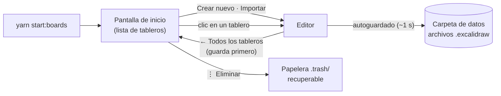
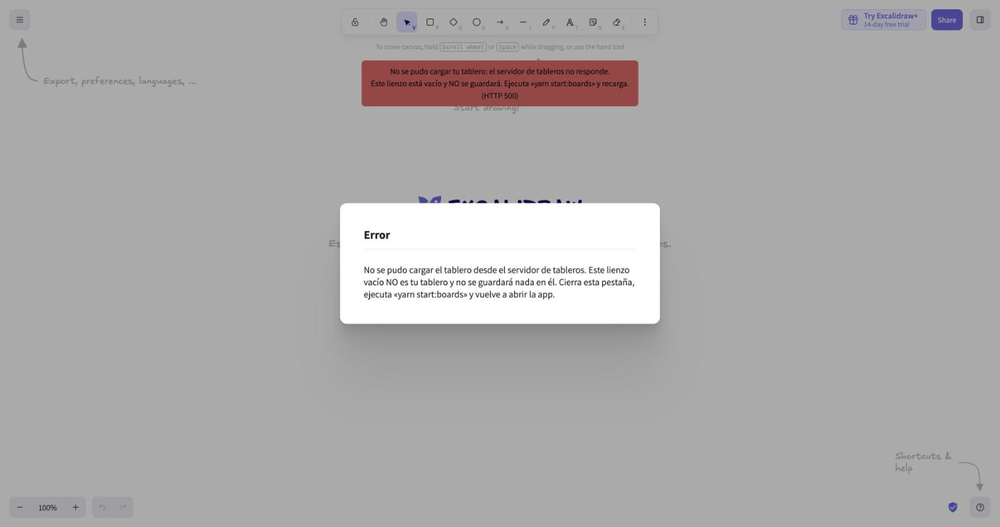
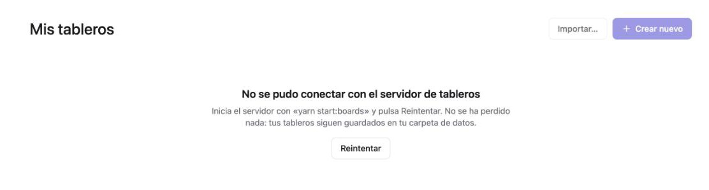
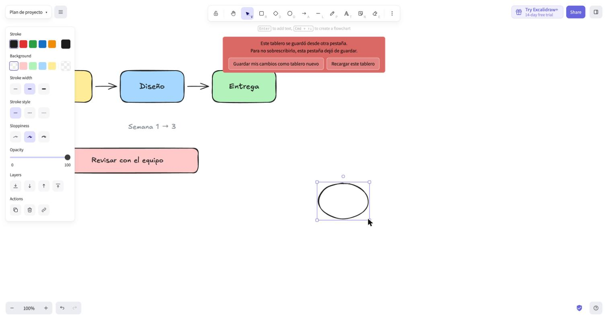

<!-- [boards] INICIO del bloque propio de este fork. Debajo, tras la línea "FIN", sigue el README original de Excalidraw sin cambios. -->

# Excalidraw con varios tableros guardados en archivos

> Fork **no oficial y de uso personal/local** de [Excalidraw](https://github.com/excalidraw/excalidraw) (licencia MIT). Añade una **pantalla de gestión de tableros** y guarda cada tablero como **un archivo en una carpeta de tu disco**, en vez de dentro del navegador.

El editor es el mismo de siempre (dibujo, texto, imágenes, exportar, tema oscuro, biblioteca, atajos…). Lo que cambia es **dónde viven tus dibujos** y **cómo los gestionas**.

## ¿Qué hace diferente este fork?

|  | Excalidraw original | Este fork |
| --- | --- | --- |
| **Cuántos dibujos** | Uno solo | **Todos los que quieras**, cada uno con su título |
| **Dónde se guardan** | En el navegador (depende del puerto, del navegador y de borrar datos del sitio) | **En archivos de una carpeta de tu disco**. Cambiar de puerto o de navegador no afecta |
| **Gestión** | — | Pantalla de inicio con **lista** (título, fecha de creación, última modificación) o **cuadrícula** con miniaturas |
| **Acciones** | — | Crear, abrir, **renombrar**, **duplicar**, **eliminar (a papelera)**, **importar** `.excalidraw`, buscar y ordenar |
| **Guardado** | Local al navegador | Autoguardado a disco, y **siempre se guarda antes de cambiar de tablero** |
| **Si algo falla** | — | Avisos claros; no se pierde el trabajo que tienes en pantalla |
| **Dos pestañas, mismo tablero** | Se sincronizan a través del navegador | Se detecta el conflicto y se ofrece **guardar tus cambios como tablero nuevo** |
| **Formato del archivo** | — | `.excalidraw` estándar (se abre en excalidraw.com con **Abrir**) |
| **Colaboración en vivo / enlaces compartidos** | Sí | **Desactivados** en este modo |

## Capturas

### Pantalla de inicio: la lista de tus tableros

Cada fila muestra el título, una miniatura del dibujo, **cuándo se creó** y **cuándo se modificó por última vez**.



### Vista de cuadrícula



### Menú de cada tablero (⋮) y eliminar a la papelera



Eliminar **siempre pide confirmación** y mueve el tablero a una papelera; no lo borra de forma definitiva:



### Dentro del editor

El botón con el nombre del tablero (arriba a la izquierda) permite **volver a todos los tableros**, **cambiar el nombre**, saltar a otro tablero o crear uno nuevo. Al cambiar, el tablero actual se guarda primero.



## Flujo de uso



1. **Arranca** con un solo comando: `yarn start:boards`.
2. En la **pantalla de inicio** crea un tablero (**Crear nuevo**), importa uno (**Importar…** o arrastra un `.excalidraw`) o abre uno existente con un clic.
3. **Dibuja.** Se guarda solo; no hay botón de guardar.
4. Para cambiar de tablero o volver al inicio usa el botón con el nombre del tablero. **Se guarda antes de salir.**
5. En el inicio puedes **buscar**, **ordenar**, **renombrar**, **duplicar** o **eliminar**.

## Cómo usarlo

**Requisitos:** [Node](https://nodejs.org) **22.18 o superior** (`node -v`) y [Yarn 1](https://classic.yarnpkg.com).

```bash
git clone https://github.com/hecastillosaenz/excalidraw-multi-boards.git
cd excalidraw-multi-boards
git checkout feature/multi-boards      # la rama con los tableros

yarn install
yarn start:boards
```

Se abre la app en <http://localhost:3001>. **Ctrl-C** detiene todo.

- `yarn start:boards` inicia **dos cosas**: el servidor de tableros (en tu máquina, puerto 3100) y la app. Si ya hay un servidor de tableros activo, lo reutiliza.
- Tus tableros se guardan en **`../data`**, una carpeta hermana de la del proyecto (por ejemplo `~/Projects/excalidraw/data`). Puedes cambiarla:

  ```bash
  BOARDS_DIR=/ruta/a/mis-tableros yarn start:boards
  ```

- ¿Otro puerto para la app? Crea el archivo `.env.development.local` con `VITE_APP_PORT=3005` (git lo ignora). **Tus tableros no cambian por eso.**

Cada tablero ocupa tres archivos en la carpeta de datos: `<id>.excalidraw` (el dibujo, con sus imágenes), `<id>.meta.json` (título y fechas) y `<id>.thumb.png` (miniatura).

## Advertencias importantes

- **Haz copias de seguridad.** Tus tableros **son la carpeta de datos**: cópiala de vez en cuando. Si la borras, se van los tableros (y también la papelera, que vive dentro).
- **El servidor de tableros tiene que estar en marcha.** Si abres solo la app (por ejemplo con `yarn start`) verás este aviso y el lienzo vacío **no se guardará**. Es a propósito: así no puedes creer que trabajas en tu tablero cuando no es así. No se pierde nada; ejecuta `yarn start:boards`.

  

  

- **Si el servidor se cae mientras dibujas**, aparece el aviso «Sin conexión con el servidor de tableros». Tus cambios siguen en pantalla y se reintenta guardar solo: **no cierres la pestaña** hasta que desaparezca (si lo haces, el navegador te avisa).
- **No abras el mismo tablero en dos pestañas a la vez.** Si ocurre, la pestaña que va por detrás se detiene para no pisar el trabajo de la otra y te ofrece guardar tus cambios como un tablero nuevo:

  

- **Eliminar no es definitivo:** el tablero va a `.trash/` dentro de la carpeta de datos y la app nunca la vacía. Para recuperarlo hay que mover sus archivos de vuelta a mano (pasos en [`README-boards.md`](README-boards.md#recuperar-un-tablero-eliminado-papelera)).
- **La carpeta de datos no puede estar dentro de un repositorio git.** El servidor se niega a arrancar si lo está, para que tus dibujos no acaben subidos a GitHub por accidente.
- **Solo para tu máquina.** El servidor escucha únicamente en `127.0.0.1` y **no tiene usuarios ni contraseña**. No lo expongas a la red (por ejemplo con `--host`).
- **Qué sigue dependiendo del navegador:** la biblioteca de formas, el tema (claro/oscuro), el idioma y los estilos de herramienta (color de trazo, etc.) se guardan en el navegador por puerto; al cambiar de puerto vuelven a sus valores por defecto. **Los tableros no.**
- **Desactivado en este modo:** colaboración en vivo y enlaces compartidos (`#room=`, `#json=`, `#url=`).
- **Móvil:** no aparece el botón del nombre del tablero; el uso previsto es de escritorio.
- **Importar:** solo archivos `.excalidraw` (hasta 50 MB). Cada archivo se convierte en un tablero nuevo; el original no se toca.
- **Sin garantías.** Es un proyecto personal basado en Excalidraw, no un producto oficial.

## Más información

- Guía completa (variables de entorno, copia de seguridad, papelera, avisos, pruebas y cómo traer cambios del Excalidraw original): [`README-boards.md`](README-boards.md)
- Diseño y decisiones: [`docs/SDD-multi-boards.md`](docs/SDD-multi-boards.md)

<!-- [boards] FIN del bloque propio de este fork. A partir de aquí: README original de Excalidraw. -->

---

<a href="https://excalidraw.com/" target="_blank" rel="noopener">
  <picture>
    <source media="(prefers-color-scheme: dark)" alt="Excalidraw" srcset="https://excalidraw.nyc3.cdn.digitaloceanspaces.com/github/excalidraw_github_cover_2_dark.png" />
    
  </picture>
</a>

<h4 align="center">
  <a href="https://excalidraw.com">Excalidraw Editor</a> |
  <a href="https://plus.excalidraw.com/blog">Blog</a> |
  <a href="https://docs.excalidraw.com">Documentation</a> |
  <a href="https://plus.excalidraw.com">Excalidraw+</a>
</h4>

<div align="center">
  <h2>
    An open source virtual hand-drawn style whiteboard. </br>
    Collaborative and end-to-end encrypted. </br>
  <br />
  </h2>
</div>

<br />
<p align="center">
  <a href="https://github.com/excalidraw/excalidraw/blob/master/LICENSE">
    </a>
  <a href="https://www.npmjs.com/package/@excalidraw/excalidraw">
    </a>
  <a href="https://docs.excalidraw.com/docs/introduction/contributing">
    </a>
  <a href="https://discord.gg/UexuTaE">
    </a>
  <a href="https://deepwiki.com/excalidraw/excalidraw">
    </a>
  <a href="https://twitter.com/excalidraw">
    </a>
</p>

<div align="center">
  <figure>
    <a href="https://excalidraw.com" target="_blank" rel="noopener">
      
    </a>
    <figcaption>
      <p align="center">
        Create beautiful hand-drawn like diagrams, wireframes, or whatever you like.
      </p>
    </figcaption>
  </figure>
</div>

## Features

The Excalidraw editor (npm package) supports:

- 💯&nbsp;Free & open-source.
- 🎨&nbsp;Infinite, canvas-based whiteboard.
- ✍️&nbsp;Hand-drawn like style.
- 🌓&nbsp;Dark mode.
- 🏗️&nbsp;Customizable.
- 📷&nbsp;Image support.
- 😀&nbsp;Shape libraries support.
- 🌐&nbsp;Localization (i18n) support.
- 🖼️&nbsp;Export to PNG, SVG & clipboard.
- 💾&nbsp;Open format - export drawings as an `.excalidraw` json file.
- ⚒️&nbsp;Wide range of tools - rectangle, circle, diamond, arrow, line, free-draw, eraser...
- ➡️&nbsp;Arrow-binding & labeled arrows.
- 🔙&nbsp;Undo / Redo.
- 🔍&nbsp;Zoom and panning support.

## Excalidraw.com

The app hosted at [excalidraw.com](https://excalidraw.com) is a minimal showcase of what you can build with Excalidraw. Its [source code](https://github.com/excalidraw/excalidraw/tree/master/excalidraw-app) is part of this repository as well, and the app features:

- 📡&nbsp;PWA support (works offline).
- 🤼&nbsp;Real-time collaboration.
- 🔒&nbsp;End-to-end encryption.
- 💾&nbsp;Local-first support (autosaves to the browser).
- 🔗&nbsp;Shareable links (export to a readonly link you can share with others).

We'll be adding these features as drop-in plugins for the npm package in the future.

## Quick start

**Note:** following instructions are for installing the Excalidraw [npm package](https://www.npmjs.com/package/@excalidraw/excalidraw) when integrating Excalidraw into your own app. To run the repository locally for development, please refer to our [Development Guide](https://docs.excalidraw.com/docs/introduction/development).

Use `npm` or `yarn` to install the package.

```bash
npm install react react-dom @excalidraw/excalidraw
# or
yarn add react react-dom @excalidraw/excalidraw
```

Check out our [documentation](https://docs.excalidraw.com/docs/@excalidraw/excalidraw/installation) for more details!

## Contributing

- Missing something or found a bug? [Report here](https://github.com/excalidraw/excalidraw/issues).
- Want to contribute? Check out our [contribution guide](https://docs.excalidraw.com/docs/introduction/contributing) or let us know on [Discord](https://discord.gg/UexuTaE).
- Want to help with translations? See the [translation guide](https://docs.excalidraw.com/docs/introduction/contributing#translating).

## Integrations

- [VScode extension](https://marketplace.visualstudio.com/items?itemName=pomdtr.excalidraw-editor)
- [npm package](https://www.npmjs.com/package/@excalidraw/excalidraw)

## Who's integrating Excalidraw

[Google Cloud](https://googlecloudcheatsheet.withgoogle.com/architecture) • [Meta](https://meta.com/) • [CodeSandbox](https://codesandbox.io/) • [Obsidian Excalidraw](https://github.com/zsviczian/obsidian-excalidraw-plugin) • [Replit](https://replit.com/) • [Slite](https://slite.com/) • [Notion](https://notion.so/) • [HackerRank](https://www.hackerrank.com/) • and many others

## Sponsors & support

If you like the project, you can become a sponsor at [Open Collective](https://opencollective.com/excalidraw) or use [Excalidraw+](https://plus.excalidraw.com/).

## Thank you for supporting Excalidraw

[](https://opencollective.com/excalidraw/tiers/sponsors/0/website) [](https://opencollective.com/excalidraw/tiers/sponsors/1/website) [](https://opencollective.com/excalidraw/tiers/sponsors/2/website) [](https://opencollective.com/excalidraw/tiers/sponsors/3/website) [](https://opencollective.com/excalidraw/tiers/sponsors/4/website) [](https://opencollective.com/excalidraw/tiers/sponsors/5/website) [](https://opencollective.com/excalidraw/tiers/sponsors/6/website) [](https://opencollective.com/excalidraw/tiers/sponsors/7/website) [](https://opencollective.com/excalidraw/tiers/sponsors/8/website) [](https://opencollective.com/excalidraw/tiers/sponsors/9/website) [](https://opencollective.com/excalidraw/tiers/sponsors/10/website)

<a href="https://opencollective.com/excalidraw#category-CONTRIBUTE" target="_blank"></a>

Last but not least, we're thankful to these companies for offering their services for free:

[](https://vercel.com) [](https://sentry.io) [](https://crowdin.com)
